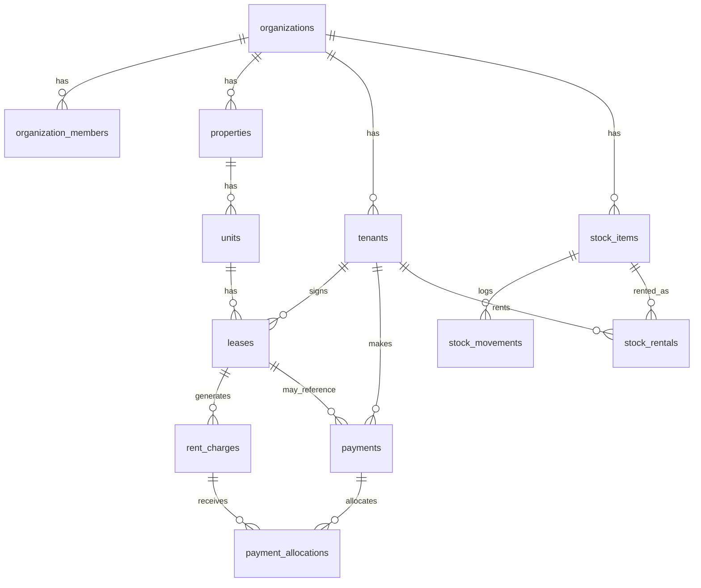

# Schema

Source of truth: `supabase/migrations/`. This document is a human-readable
summary; regenerate the DB types with `pnpm gen:types` after migrations change.

## Entity relationships

```
auth.users 1─1 profiles(id)
organizations 1─* organization_members(org_id) *─1 auth.users(user_id)
organizations 1─* invitations(org_id)
organizations 1─* properties(org_id) 1─* units(property_id)
organizations 1─* tenants(org_id);  tenants.user_id → auth.users (optional)
units 1─* leases(unit_id) *─1 tenants(tenant_id)        [one ACTIVE lease per unit]
leases 1─* rent_charges(lease_id)
tenants 1─* payments(tenant_id);  payments.lease_id → leases (nullable)
payments 1─* payment_allocations(payment_id) *─1 rent_charges(charge_id)
properties 1─* stock_items(property_id, nullable)
stock_items 1─* stock_movements(item_id);  stock_movements.unit_id → units (nullable)
stock_items 1─* stock_rentals(item_id) *─1 tenants(tenant_id)
units 1─* maintenance_requests(unit_id)
auth.users 1─* device_tokens, notifications(user_id)
every business table: org_id → organizations(id)
```



## Tables

| Table | Purpose | Soft delete |
|---|---|---|
| `profiles` | 1-1 with `auth.users`; name/phone/locale/`is_platform_admin` | no |
| `organizations` | tenant root; currency, timezone, billing defaults | yes |
| `organization_members` | role + status per user per org (composite PK) | no |
| `invitations` | pending invites; stores `token_hash` only | no |
| `properties` | residential/commercial/mixed_use | yes |
| `units` | shops/apartments/offices/storage; unique `(property_id, code)` | yes |
| `tenants` | people/businesses; optional `user_id` link | yes |
| `leases` | one ACTIVE per unit (partial unique index) | no |
| `rent_charges` | monthly charges; unique `(lease_id, period_start)` | no |
| `payments` | receipts; `unallocated_amount`; idempotency key | no (void) |
| `payment_allocations` | payment → charge amounts | no |
| `org_counters` | atomic counters (receipt numbers) | no |
| `stock_items` | inventory; `min_quantity`, `is_rentable` | yes |
| `stock_movements` | in/out/adjustment/rental logs with `balance_after` | no |
| `stock_rentals` | rentable stock lent to tenants | no |
| `maintenance_requests` | optional module (flagged) | no |
| `notifications` | in-app/push/sms/email queue + read state | no |
| `device_tokens` | push tokens per user | no |
| `audit_logs` | append-only, trigger-written | no |
| `app_event_logs` | append-only client/edge events | no |
| `app_versions` | version gate rows per platform | no |
| `feature_flags` | global or per-org flags | no |

## Enums

`org_role`, `property_type`, `unit_status`, `lease_status`, `charge_status`,
`payment_method`, `stock_movement_type`, `notification_channel`.

## Conventions

- `uuid` PKs (`gen_random_uuid()`), `created_at`/`updated_at timestamptz`.
- Snake_case; enums for fixed sets; check constraints for ranges.
- Index every foreign key and every `org_id`.
- RLS helpers use `(select auth.uid())` for per-statement caching.
- `security definer` functions set `search_path = public` and have execute revoked
  from `public`/`anon`.

## RLS summary

| Table | Read | Write |
|---|---|---|
| profiles | own row; co-members' name/phone | own row (column-granted; cannot self-set `is_platform_admin`) |
| organizations | members | owner |
| organization_members | members | `admin_*` RPC only |
| properties, units | members | owner, manager |
| tenants, leases | members; tenant reads own | owner/manager (staff may create tenants) |
| rent_charges | members; tenant reads own | RPC only |
| payments, payment_allocations | members; tenant reads own | RPC only |
| stock_items | members | owner, manager, staff |
| stock_movements | members | RPC only |
| stock_rentals | members | RPC only |
| notifications | recipient | recipient marks read |
| device_tokens | own | own |
| audit_logs | org owner/manager; platform admin | none (trigger) |
| app_event_logs | platform admin | `log_client_event` RPC |
| app_versions | platform admin (anon via RPC) | platform admin RPC |
| feature_flags | members (global + own org) | platform admin RPC |
